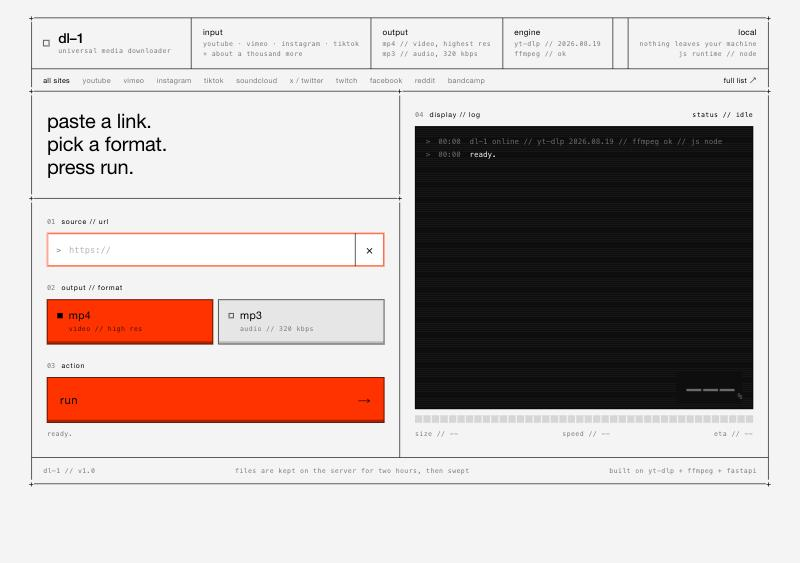

# dl-1 — universal media downloader

paste a link from youtube, instagram, tiktok, vimeo (and about a thousand other sites), pick **mp4** or **mp3**, press run. the file lands in your browser's downloads. everything runs on your own machine — nothing is uploaded anywhere.

built on [yt-dlp](https://github.com/yt-dlp/yt-dlp) + ffmpeg + fastapi. front panel in the teenage engineering idiom: off-white chassis, black lines, one orange, no rounded corners, everything lowercase.



---

## run it

```bash
bash run.sh
```

then open **http://127.0.0.1:3300**. ctrl+c stops it.

first run takes a minute: the script makes a virtualenv in `.venv/` and installs the requirements. after that it starts in a second.

**no python 3.10+ on your mac?** (the one apple ships is 3.9, and current yt-dlp needs 3.10+.) the script notices, downloads [`uv`](https://github.com/astral-sh/uv) and a standalone python 3.12 into `.tools/` inside this folder, and carries on. nothing is installed system-wide. delete `.tools/` and `.venv/` and it's like it never happened.

**no ffmpeg?** also fine. `requirements.txt` pulls in `imageio-ffmpeg`, which bundles an ffmpeg binary. if you do have ffmpeg on your path it's used instead.

other ways to start it, once set up:

```bash
.venv/bin/python server.py                       # same thing, no bash
.venv/bin/python -m uvicorn server:app --reload  # auto-reload while you hack on it
bash run.sh --reset                              # nuke the env and rebuild it
```

---

## make it a mac app

```bash
.venv/bin/python make_app.py
```

that builds `dl-1.app`, copies it to `/Applications`, and puts it in the dock. click the icon: a window opens on the panel, the server runs inside it, quit the app and it's all gone. saves land in `~/Downloads` and finder reveals them.

the app is a thin shell pointing at this folder, so if you move or rename the folder, run `make_app.py` again. `make_app.py --no-dock` skips the dock, `--build-only` just writes `dist/dl-1.app`.

---

## share it with someone

```bash
.venv/bin/python make_app.py --share
```

that writes two files into `dist/`:

- **`dl-1-mac.zip`** — a self-contained `dl-1.app` with python, the packages and ffmpeg all inside. for apple silicon macs (m1 and newer). they unzip it, drag it to applications, done. roughly 100 mb.
- **`dl-1-source.zip`** — the code only, for intel macs or anyone comfortable with a terminal. they unzip, run `bash run.sh --setup` then `.venv/bin/python make_app.py`, and get the same app built for their machine.

**the one-time gatekeeper step.** the app isn't signed with an apple developer id, so the first launch gets blocked: macos says it "could not verify" the app. they click done, open **system settings → privacy & security**, scroll down to the line that says dl-1 was blocked, click **open anyway**, and confirm. after that it opens like any other app. (terminal alternative: `xattr -dr com.apple.quarantine /Applications/dl-1.app`.)

the shared app keeps its own files out of the way: log at `~/Library/Logs/dl-1.log`, working files in `~/Library/Caches/dl-1/`, saves in `~/Downloads`.

---

## how it works

```
browser ── POST /api/jobs ──▶ server.py ──▶ jobs.py (worker pool) ──▶ downloader.py (yt-dlp + ffmpeg)
   ▲                                                   │
   └──── GET /api/jobs/{id}/events (server-sent events) ┘   log / progress / done
   └──── GET /api/jobs/{id}/file   ──▶ the finished mp4 / mp3
```

| file | job |
| --- | --- |
| `server.py` | the http layer. routes, url validation, the event stream, file delivery. |
| `jobs.py` | in-memory job registry + thread pool. one folder per job under `downloads/`. sweeps old jobs. |
| `downloader.py` | the engine. one function, `download(url, fmt, out_dir, emit)`, no web stuff in it — reuse it anywhere. format presets live at the top. |
| `static/` | the front panel. plain html / css / js, no build step. |
| `run.sh` | setup + launch. |
| `app.py` + `make_app.py` + `launcher/` | the mac app: a native window around the same server, and the script that builds + installs it. |

**mp4** = best h.264 video + aac audio the site offers, merged into one mp4. that's the highest resolution that still plays everywhere and cuts cleanly in premiere / resolve / final cut (on youtube that's 1080p; 4k there is av1 / vp9 only). if a site only serves vp9 / av1 / hevc (instagram often does), the file is re-encoded to h.264 on the way out, hardware-accelerated on apple silicon, so quicktime, finder and your editor all play it. the log says when that happened. want max resolution regardless of codec? change one selector in `FORMATS["mp4"]` in `downloader.py` — the comment next to it tells you what to paste.

**mp3** = best audio stream, transcoded to 320 kbps mp3, with title / artist metadata and the thumbnail embedded as cover art.

adding a preset is one dict entry in `FORMATS`. it shows up in `/api/health` automatically; add a key to the switch in `index.html` to expose it on the panel.

---

## api

| method | path | what |
| --- | --- | --- |
| `GET` | `/api/health` | yt-dlp version, ffmpeg + js runtime status, available formats |
| `POST` | `/api/jobs` | `{"url": "...", "format": "mp4"}` → `202 {"id": "..."}` |
| `GET` | `/api/jobs/{id}` | job summary |
| `GET` | `/api/jobs/{id}/events` | server-sent events: `log` `meta` `status` `progress` `done` `error` `end` |
| `GET` | `/api/jobs/{id}/file` | the finished file |
| `DELETE` | `/api/jobs/{id}` | stop a running job |

interactive docs at `/docs` while the server is running. errors come back as `{"detail": "a plain-language message"}`.

---

## settings

all optional, all environment variables:

| variable | default | what |
| --- | --- | --- |
| `DL1_PORT` / `DL1_HOST` | `3300` / `127.0.0.1` | where it listens. set host to `0.0.0.0` to reach it from your phone on the same wifi. |
| `DL1_DOWNLOAD_DIR` | `./downloads` | where job folders go |
| `DL1_MAX_WORKERS` | `2` | parallel downloads |
| `DL1_RETENTION_MINUTES` | `120` | finished files are deleted from the server after this. save them from the browser. |
| `DL1_FFMPEG` | auto | path to an ffmpeg binary |
| `DL1_JS_RUNTIME` | auto | `node:/path/to/node` — see "youtube + javascript" below |
| `DL1_COOKIES_FROM_BROWSER` | off | `chrome`, `firefox`, `safari`, `brave`, `edge` — see "logins" below |
| `DL1_COOKIES_FILE` | off | path to a netscape-format `cookies.txt` |

example: `DL1_PORT=8080 DL1_COOKIES_FROM_BROWSER=chrome bash run.sh`

---

## when something doesn't download

the log on the panel says why in plain words. the usual suspects:

**"this one needs a login"** — instagram, most of vimeo these days, age-gated youtube, anything private-but-you-have-access. hand yt-dlp your browser's cookies:

```bash
DL1_COOKIES_FROM_BROWSER=chrome bash run.sh
```

use whichever browser you're logged into those sites with. on macos, chrome will ask for keychain access the first time. (safari works too but needs full disk access for terminal.) only do this for your own accounts, obviously.

**"the site wants proof you're not a bot"** — youtube rate-limiting. wait a minute. if it keeps happening, cookies (above) usually clear it.

**youtube + javascript** — youtube now wants a javascript runtime to unlock all of its formats. dl-1 looks for `deno`, `node` or `bun` on your path (and a few usual spots) and uses whatever it finds. with none, youtube still works today but with a warning and possibly fewer formats. easiest fix: install [deno](https://deno.com) (`curl -fsSL https://deno.land/install.sh | sh`), restart dl-1.

**yt-dlp is out of date** — sites change, yt-dlp keeps up, you have to keep up with yt-dlp. every few weeks:

```bash
.venv/bin/python -m pip install -U yt-dlp
```

(or `.tools/uv pip install --python .venv/bin/python -U yt-dlp` if the script set you up with uv.) the version is printed in the top bar.

**"ffmpeg is missing"** — shouldn't happen with the bundled binary, but if you removed `imageio-ffmpeg`, either put it back or install ffmpeg and point `DL1_FFMPEG` at it.

---

## notes

- files sit in `downloads/<job id>/` for two hours after they finish, then get swept. the browser's save button is the keeper.
- playlist links download just the linked video, on purpose.
- one job per browser tab, but the server runs several in parallel; open more tabs.
- download things you have the rights to. this is a tool for your own content, licensed material, and references — the sites' terms of service still apply to you.
